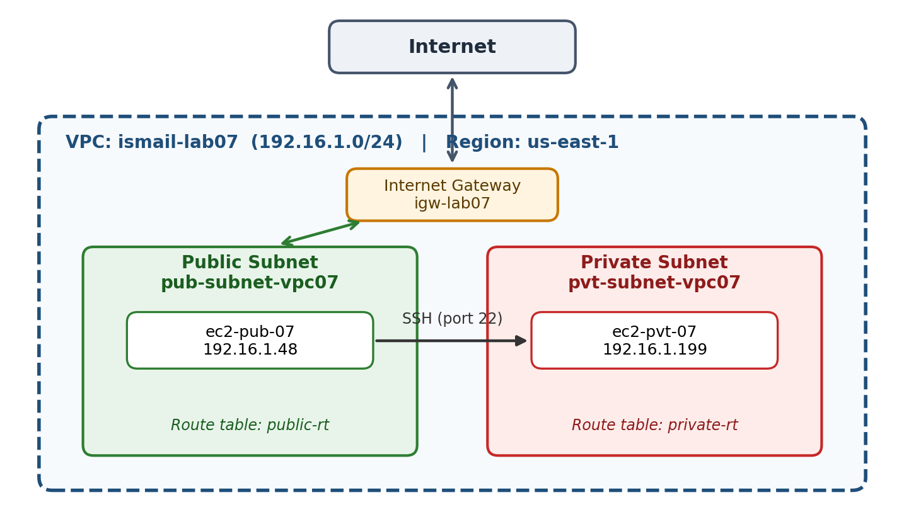
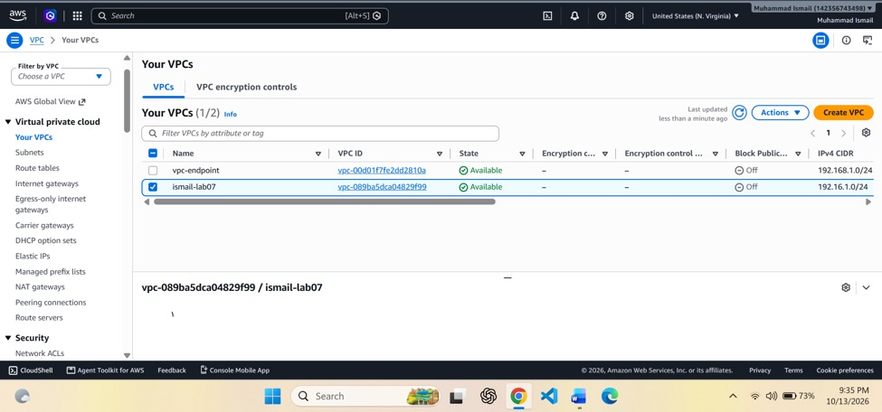
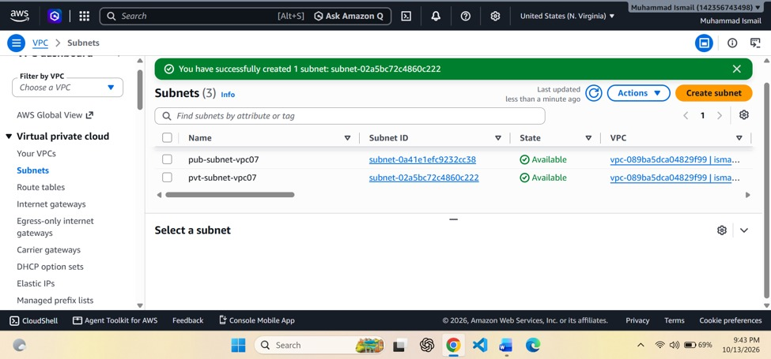
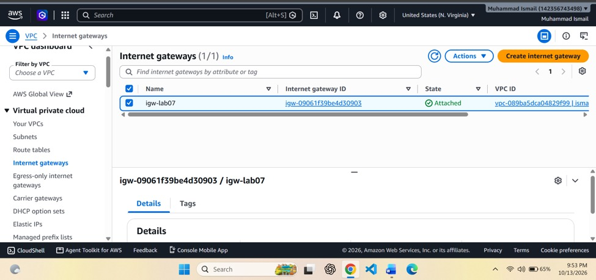
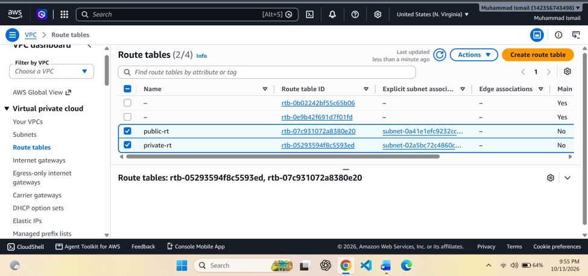
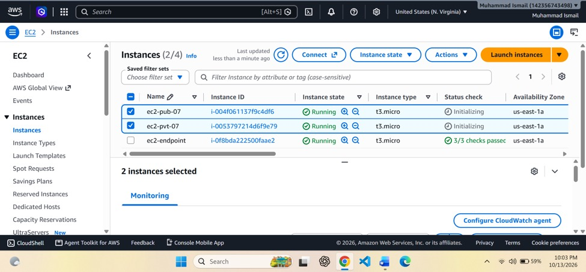
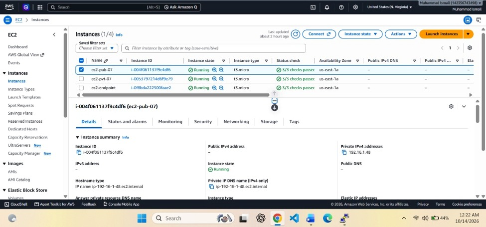
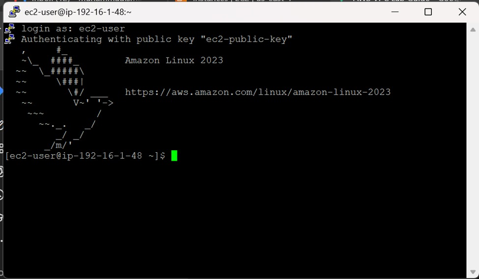
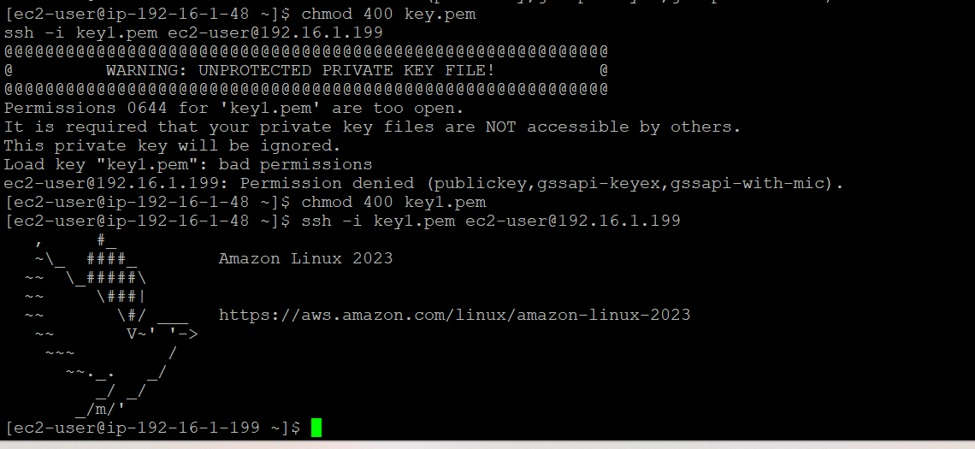
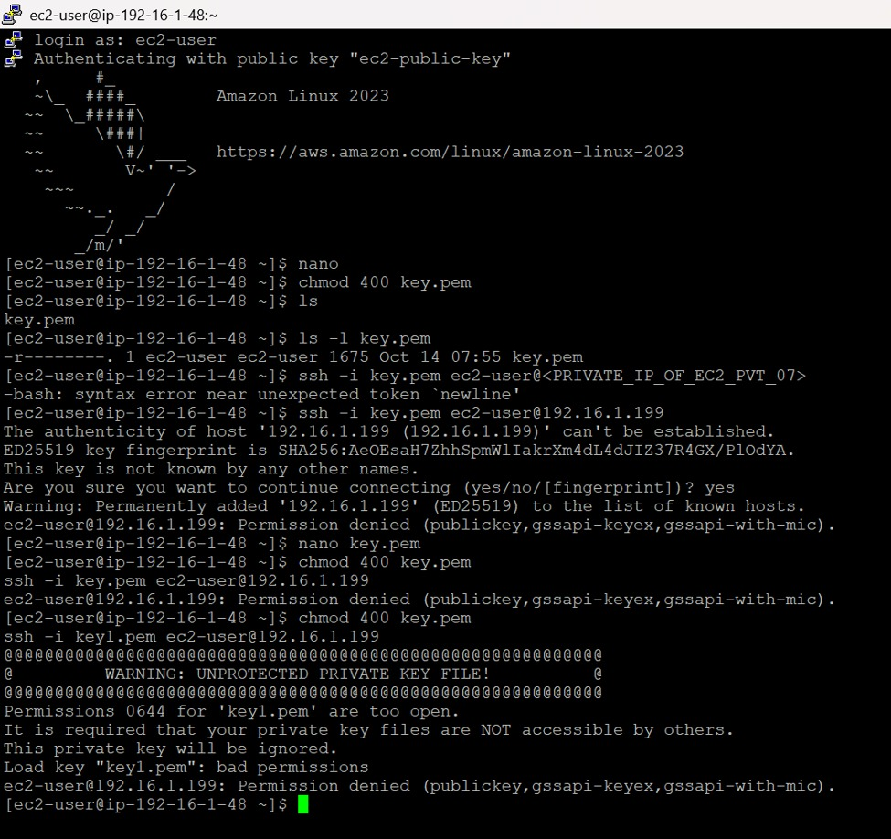

# Secure Multi-Tier Network on AWS: Custom VPC with Public/Private Subnets and Bastion Access


A hands-on cloud networking project that builds a custom **Amazon VPC** from scratch, with a **public subnet**, a **private subnet**, an **Internet Gateway**, and **separate route tables**. Two EC2 instances are deployed, and the private instance is reached over **SSH through the public instance** (the *bastion host* pattern).

> Completed as **Lab 07** of the *Cloud Computing* course (13-14 October 2026).

---

## Table of Contents
- [Secure Multi-Tier Network on AWS: Custom VPC with Public/Private Subnets and Bastion Access](#secure-multi-tier-network-on-aws-custom-vpc-with-publicprivate-subnets-and-bastion-access)
  - [Table of Contents](#table-of-contents)
  - [Architecture](#architecture)
  - [AWS Services Used](#aws-services-used)
  - [Resources Created](#resources-created)
  - [Implementation Steps](#implementation-steps)
    - [1. Create the VPC](#1-create-the-vpc)
    - [2. Create the subnets](#2-create-the-subnets)
    - [3. Create and attach the Internet Gateway](#3-create-and-attach-the-internet-gateway)
    - [4. Configure route tables](#4-configure-route-tables)
    - [5. Launch the EC2 instances](#5-launch-the-ec2-instances)
  - [Connecting to the Private Instance](#connecting-to-the-private-instance)
  - [Troubleshooting Log](#troubleshooting-log)
  - [Key Learnings](#key-learnings)
  - [Cleanup](#cleanup)
  - [Future Improvements](#future-improvements)
  - [Repository Structure](#repository-structure)
  - [Author](#author)

---

## Architecture



The VPC (`192.16.1.0/24`) contains two subnets. The **public subnet** is associated with `public-rt` and hosts the bastion instance. The **private subnet** is associated with its own route table (`private-rt`) and hosts the internal instance. The private instance is administered only by connecting to it from the public instance.

## AWS Services Used

| Service | Purpose |
|---|---|
| Amazon VPC | Isolated virtual network (`192.16.1.0/24`) |
| Subnets | Public and private network segments |
| Internet Gateway | Connects the VPC to the internet |
| Route Tables | Separate routing for the public and private tiers |
| Amazon EC2 | `t3.micro` instances running Amazon Linux 2023 |
| SSH (key pairs) | Key-based authentication to instances |

## Resources Created

| Resource | Name | Identifier |
|---|---|---|
| VPC | `ismail-lab07` | `vpc-089ba5dca04829f99` (192.16.1.0/24) |
| Public subnet | `pub-subnet-vpc07` | `subnet-0a41e1efc9232cc38` |
| Private subnet | `pvt-subnet-vpc07` | `subnet-02a5bc72c4860c222` |
| Internet Gateway | `igw-lab07` | `igw-09061f39be4d30903` |
| Public route table | `public-rt` | `rtb-07c931072a8380e20` |
| Private route table | `private-rt` | `rtb-05293594f8c5593ed` |
| Public EC2 instance | `ec2-pub-07` | `i-004f061137f9c4df6` (private IP 192.16.1.48) |
| Private EC2 instance | `ec2-pvt-07` | `i-0053797214d6f9e79` (private IP 192.16.1.199) |

## Implementation Steps

### 1. Create the VPC
Created `ismail-lab07` with IPv4 CIDR `192.16.1.0/24` in **us-east-1 (N. Virginia)**.



### 2. Create the subnets
Created `pub-subnet-vpc07` and `pvt-subnet-vpc07` inside the VPC (non-overlapping ranges within the VPC CIDR).



### 3. Create and attach the Internet Gateway
Created `igw-lab07` and attached it to the VPC (state: **Attached**).



### 4. Configure route tables
Created `public-rt` and `private-rt` and explicitly associated each with its subnet. In a standard public-subnet setup, `public-rt` carries a default route (`0.0.0.0/0`) to the Internet Gateway, while `private-rt` has no route to it.



### 5. Launch the EC2 instances
Launched `ec2-pub-07` (public subnet) and `ec2-pvt-07` (private subnet), both `t3.micro` in `us-east-1a`.



After initialisation, the public instance passed all 3/3 status checks with private IP `192.16.1.48`.



## Connecting to the Private Instance

**Step 1: SSH into the public instance** (PuTTY, user `ec2-user`, key-based authentication):



**Step 2: From the public instance, hop to the private instance:**

```bash
nano key.pem                 # paste the private key contents
chmod 400 key.pem            # SSH requires owner-read-only permissions
ssh -i key.pem ec2-user@192.16.1.199
```

**Step 3: Verify.** The prompt changes from `ip-192-16-1-48` to `ip-192-16-1-199`, confirming access to the private instance:



## Troubleshooting Log

The connection failed at first. Working through the errors was the most instructive part of the lab.

| # | Error | Likely cause | Fix |
|---|---|---|---|
| 1 | `bash: syntax error near unexpected token 'newline'` | The placeholder `<PRIVATE_IP_OF_EC2_PVT_07>` was typed literally; the shell read `<` `>` as redirection | Used the real private IP `192.16.1.199` |
| 2 | `Permission denied (publickey,...)` with `key.pem` | The key file used was not accepted by the private instance | Switched to the correct key file (`key1.pem`) |
| 3 | `WARNING: UNPROTECTED PRIVATE KEY FILE! Permissions 0644 ... are too open` | SSH refuses private keys readable by other users | `chmod 400 key1.pem` |
| 4 | Login succeeded | n/a | Connectivity verified |



## Key Learnings

- How a VPC, subnets, route tables and an Internet Gateway fit together.
- The difference between a **public** and a **private** subnet, determined by routing, not by a setting on the subnet itself.
- The **bastion host** pattern: expose one hardened entry point and keep internal servers off the public internet.
- SSH key hygiene: correct key pair, `chmod 400`, and never pasting placeholders into commands.
- Reading and interpreting SSH error messages methodically.

## Cleanup

To avoid unexpected AWS charges, delete resources when finished, in this order:

1. Terminate `ec2-pub-07` and `ec2-pvt-07`
2. Detach and delete `igw-lab07`
3. Delete the subnets and the custom route tables
4. Delete the VPC `ismail-lab07`

## Future Improvements

- [ ] Rebuild the whole environment as **Infrastructure as Code** (Terraform / CloudFormation)
- [ ] Add a **NAT Gateway** so the private instance can reach the internet for updates
- [ ] Document **security group** and **network ACL** rules
- [ ] Replace SSH key hops with **AWS Systems Manager Session Manager**
- [ ] Add **VPC Flow Logs** and CloudWatch monitoring

## Repository Structure

```
aws-vpc-public-private-subnet-bastion/
├── README.md
├── .gitignore
├── architecture/
│   └── diagram.png
├── screenshots/
│   └── 01-vpc.jpeg ... 09-ssh-private-instance-success.jpeg
└── docs/
    └── Cloud_Computing_Lab07_Report.docx
```

## Author

**Muhammad Ismail** — aspiring Cloud Engineer | AWS | AI & Data Science

> **Security note:** No private keys or credentials are stored in this repository. `.gitignore` excludes `*.pem` and `*.ppk` files, and the AWS account ID has been blurred in the screenshots.